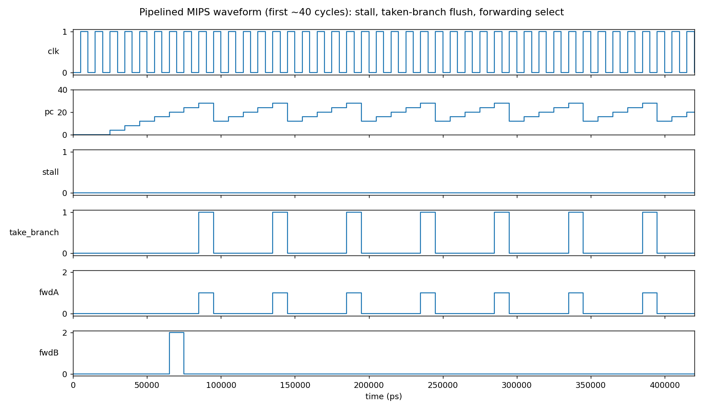

# 5-Stage Pipelined MIPS Processor — Project Report

## 1. Problem Statement
Design, implement and verify a 5-stage pipelined MIPS processor (IF, ID, EX, MEM, WB) in Verilog that executes
`add, sub, and, or, slt, addi, lw, sw, beq, bne`. Pipelining raises throughput toward 1 instruction/cycle, but
introduces hazards that must be handled in hardware:
* **Data hazards (RAW)** – solved by forwarding from EX/MEM and MEM/WB to the ALU inputs.
* **Load-use hazard** – one-cycle stall plus bubble insertion.
* **Control hazards** – branches resolved in EX; a taken branch flushes the 2 younger instructions.

The design is verified with a Verilog testbench and compared at cycle level with the gem5 simulator's in-order
pipelined MIPS CPU model (`MipsMinorCPU`).

## 2. Circuit, Truth Table, FSM
**Circuit (datapath):** PC -> Instruction memory -> [IF/ID] -> Control + Register file -> [ID/EX] -> Forwarding muxes
-> ALU / branch comparator -> [EX/MEM] -> Data memory -> [MEM/WB] -> write-back mux -> Register file.
A hazard-detection unit controls PC/IF-ID hold and ID/EX bubble; a forwarding unit selects ALU operands.

**Control truth table**

| Instr | opcode | RegWrite | RegDst | ALUSrc | MemRead | MemWrite | MemToReg | Branch | ALUop |
|---|---|---|---|---|---|---|---|---|---|
| R-type | 000000 | 1 | 1 | 0 | 0 | 0 | 0 | 0 | by funct |
| addi | 001000 | 1 | 0 | 1 | 0 | 0 | 0 | 0 | add |
| lw | 100011 | 1 | 0 | 1 | 1 | 0 | 1 | 0 | add |
| sw | 101011 | 0 | x | 1 | 0 | 1 | x | 0 | add |
| beq | 000100 | 0 | x | 0 | 0 | 0 | x | 1 (zero) | sub |
| bne | 000101 | 0 | x | 0 | 0 | 0 | x | 1 (!zero) | sub |

ALU ops: 0 add, 1 sub, 2 and, 3 or, 4 slt. R-type funct: 20 add, 22 sub, 24 and, 25 or, 2A slt.

**Forwarding:** ForwardX = 1 (EX/MEM) if `EX/MEM.RegWrite & EX/MEM.Rd!=0 & EX/MEM.Rd==ID/EX.Rx`; else 2 (MEM/WB) under the same
condition on MEM/WB; else 0 (register file).
**Load-use stall:** `ID/EX.MemRead & (ID/EX.Rt==IF/ID.Rs | ID/EX.Rt==IF/ID.Rt)`.

**FSM:** Not applicable — the processor is a pipelined datapath with combinational control (no controller FSM).

## 3. Brief Literature Survey
* D. A. Patterson and J. L. Hennessy, *Computer Organization and Design: The Hardware/Software Interface*, MIPS Edition, Morgan Kaufmann, 2013 — the classic 5-stage pipeline, forwarding and hazard-detection units used here.
* J. L. Hennessy and D. A. Patterson, *Computer Architecture: A Quantitative Approach*, 6th ed., Morgan Kaufmann, 2017 — pipeline performance (CPI = 1 + stalls per instruction) and branch handling.
* N. Binkert et al., "The gem5 Simulator", ACM SIGARCH Computer Architecture News 39(2), 2011 — architectural simulator used for the cycle-level comparison; its `MinorCPU` is an in-order pipelined model.
* G. Kane and J. Heinrich, *MIPS RISC Architecture*, Prentice Hall, 1992; MIPS32 Architecture manuals — instruction encodings.

## 4. Verilog Code, Testbench and Output
### 4.1 Design (`verilog/pipelined_mips.v`)
```verilog
`timescale 1ns/1ps
// 5-stage pipelined MIPS (IF, ID, EX, MEM, WB)
// Supports: add sub and or slt addi lw sw beq bne
// Hazards : full forwarding (EX/MEM, MEM/WB -> EX), load-use stall (1 cycle),
//           branches resolved in EX (taken branch flushes 2 instructions)
module pipelined_mips(input clk, input reset);
  // ---------------- state ----------------
  reg [31:0] pc;
  reg [31:0] imem [0:63];
  reg [31:0] dmem [0:63];
  reg [31:0] rf   [0:31];

  // pipeline registers
  reg [31:0] ifid_instr, ifid_pc4;
  // ID/EX
  reg [31:0] idex_a, idex_b, idex_imm, idex_pc4;
  reg [4:0]  idex_rs, idex_rt, idex_rd;
  reg        idex_regwrite, idex_memtoreg, idex_memread, idex_memwrite;
  reg        idex_alusrc, idex_regdst, idex_beq, idex_bne;
  reg [2:0]  idex_aluop;
  // EX/MEM
  reg [31:0] exmem_alu, exmem_wdata;
  reg [4:0]  exmem_wr;
  reg        exmem_regwrite, exmem_memtoreg, exmem_memread, exmem_memwrite;
  // MEM/WB
  reg [31:0] memwb_alu, memwb_rdata;
  reg [4:0]  memwb_wr;
  reg        memwb_regwrite, memwb_memtoreg;

  // performance counters
  integer cycles, stalls, flushes, retired;

  // ---------------- ID stage ----------------
  wire [5:0] opcode = ifid_instr[31:26];
  wire [4:0] rs = ifid_instr[25:21], rt = ifid_instr[20:16], rd = ifid_instr[15:11];
  wire [5:0] funct = ifid_instr[5:0];
  wire [31:0] imm_se = {{16{ifid_instr[15]}}, ifid_instr[15:0]};

  reg c_regwrite, c_memtoreg, c_memread, c_memwrite, c_alusrc, c_regdst, c_beq, c_bne;
  reg [2:0] c_aluop;   // 0 add,1 sub,2 and,3 or,4 slt
  always @* begin
    {c_regwrite,c_memtoreg,c_memread,c_memwrite,c_alusrc,c_regdst,c_beq,c_bne} = 8'b0;
    c_aluop = 3'd0;
    case (opcode)
      6'h00: if (ifid_instr != 0) begin
               c_regwrite = 1; c_regdst = 1;
               case (funct)
                 6'h20: c_aluop = 0; 6'h22: c_aluop = 1; 6'h24: c_aluop = 2;
                 6'h25: c_aluop = 3; 6'h2A: c_aluop = 4;
                 default: c_regwrite = 0;
               endcase
             end
      6'h08: begin c_regwrite = 1; c_alusrc = 1; end              // addi
      6'h23: begin c_regwrite = 1; c_alusrc = 1; c_memread = 1; c_memtoreg = 1; end // lw
      6'h2B: begin c_alusrc = 1; c_memwrite = 1; end              // sw
      6'h04: begin c_beq = 1; c_aluop = 1; end                    // beq
      6'h05: begin c_bne = 1; c_aluop = 1; end                    // bne
    endcase
  end

  // register read with WB->ID bypass (write in first half of cycle)
  wire [31:0] rd1 = (rs == 0) ? 0 : (memwb_regwrite && memwb_wr == rs) ? (memwb_memtoreg ? memwb_rdata : memwb_alu) : rf[rs];
  wire [31:0] rd2 = (rt == 0) ? 0 : (memwb_regwrite && memwb_wr == rt) ? (memwb_memtoreg ? memwb_rdata : memwb_alu) : rf[rt];

  // load-use hazard detection
  wire stall = idex_memread && (idex_rt != 0) && (idex_rt == rs || idex_rt == rt);

  // ---------------- EX stage ----------------
  wire [1:0] fwdA = (exmem_regwrite && exmem_wr != 0 && exmem_wr == idex_rs) ? 2'd1 :
                    (memwb_regwrite && memwb_wr != 0 && memwb_wr == idex_rs) ? 2'd2 : 2'd0;
  wire [1:0] fwdB = (exmem_regwrite && exmem_wr != 0 && exmem_wr == idex_rt) ? 2'd1 :
                    (memwb_regwrite && memwb_wr != 0 && memwb_wr == idex_rt) ? 2'd2 : 2'd0;
  wire [31:0] wb_val = memwb_memtoreg ? memwb_rdata : memwb_alu;
  wire [31:0] opA = fwdA == 1 ? exmem_alu : fwdA == 2 ? wb_val : idex_a;
  wire [31:0] opB_pre = fwdB == 1 ? exmem_alu : fwdB == 2 ? wb_val : idex_b;
  wire [31:0] opB = idex_alusrc ? idex_imm : opB_pre;

  reg [31:0] alu_out;
  always @* case (idex_aluop)
    0: alu_out = opA + opB;
    1: alu_out = opA - opB;
    2: alu_out = opA & opB;
    3: alu_out = opA | opB;
    4: alu_out = ($signed(opA) < $signed(opB)) ? 32'd1 : 32'd0;
    default: alu_out = 0;
  endcase
  wire zero = (alu_out == 0);
  wire take_branch = (idex_beq && zero) || (idex_bne && !zero);
  wire [31:0] branch_target = idex_pc4 + (idex_imm << 2);

  // ---------------- MEM stage ----------------
  wire [31:0] mem_rdata = dmem[exmem_alu[7:2]];

  // ---------------- sequential logic ----------------
  integer i;
  always @(posedge clk) begin
    if (reset) begin
      pc <= 0; ifid_instr <= 0; ifid_pc4 <= 0;
      idex_regwrite <= 0; idex_memread <= 0; idex_memwrite <= 0; idex_beq <= 0; idex_bne <= 0;
      idex_memtoreg <= 0; idex_rt <= 0; idex_rs <= 0; idex_rd <= 0; idex_aluop <= 0;
      idex_alusrc <= 0; idex_regdst <= 0; idex_a <= 0; idex_b <= 0; idex_imm <= 0; idex_pc4 <= 0;
      exmem_regwrite <= 0; exmem_memwrite <= 0; exmem_memread <= 0; exmem_memtoreg <= 0;
      exmem_alu <= 0; exmem_wdata <= 0; exmem_wr <= 0;
      memwb_regwrite <= 0; memwb_memtoreg <= 0; memwb_alu <= 0; memwb_rdata <= 0; memwb_wr <= 0;
      cycles <= 0; stalls <= 0; flushes <= 0; retired <= 0;
    end else begin
      cycles <= cycles + 1;
      // WB
      if (memwb_regwrite && memwb_wr != 0) rf[memwb_wr] <= wb_val;
      if (memwb_regwrite || memwb_wr != 0) ; // (retire counting below)
      // MEM
      if (exmem_memwrite) dmem[exmem_alu[7:2]] <= exmem_wdata;
      memwb_regwrite <= exmem_regwrite; memwb_memtoreg <= exmem_memtoreg;
      memwb_alu <= exmem_alu; memwb_rdata <= mem_rdata; memwb_wr <= exmem_wr;
      // EX
      exmem_regwrite <= idex_regwrite; exmem_memtoreg <= idex_memtoreg;
      exmem_memread <= idex_memread;  exmem_memwrite <= idex_memwrite;
      exmem_alu <= alu_out; exmem_wdata <= opB_pre;
      exmem_wr <= idex_regdst ? idex_rd : idex_rt;
      // ID / IF with hazard control
      if (take_branch) begin
        flushes <= flushes + 2;
        pc <= branch_target;
        ifid_instr <= 0; ifid_pc4 <= 0;
        idex_regwrite <= 0; idex_memread <= 0; idex_memwrite <= 0; idex_beq <= 0; idex_bne <= 0; idex_memtoreg <= 0;
        idex_rt <= 0; idex_rs <= 0; idex_rd <= 0;
      end else if (stall) begin
        stalls <= stalls + 1;                       // hold PC and IF/ID, insert bubble
        idex_regwrite <= 0; idex_memread <= 0; idex_memwrite <= 0; idex_beq <= 0; idex_bne <= 0; idex_memtoreg <= 0;
        idex_rt <= 0; idex_rs <= 0; idex_rd <= 0;
      end else begin
        pc <= pc + 4;
        ifid_instr <= imem[pc[7:2]]; ifid_pc4 <= pc + 4;
        idex_a <= rd1; idex_b <= rd2; idex_imm <= imm_se; idex_pc4 <= ifid_pc4;
        idex_rs <= rs; idex_rt <= rt; idex_rd <= rd;
        idex_regwrite <= c_regwrite; idex_memtoreg <= c_memtoreg; idex_memread <= c_memread;
        idex_memwrite <= c_memwrite; idex_alusrc <= c_alusrc; idex_regdst <= c_regdst;
        idex_beq <= c_beq; idex_bne <= c_bne; idex_aluop <= c_aluop;
      end
    end
  end
endmodule
```
### 4.2 Testbench (`verilog/pipelined_mips_tb.v`)
Test program: sum 1..10 in a loop (RAW hazards, bne taken 9 times), `sw`/`lw` and a dependent `add` (load-use), then `sub`, `and`, `or`, `slt` and a taken `beq` (skips one instruction), then a self-branch halt. All 10 instruction types are exercised.
```verilog
`timescale 1ns/1ps
module pipelined_mips_tb;
  reg clk = 0, reset = 1;
  pipelined_mips dut(.clk(clk), .reset(reset));
  always #5 clk = ~clk;

  function [31:0] R(input [5:0] fn, input [4:0] rs, rt, rd);  R = {6'd0, rs, rt, rd, 5'd0, fn}; endfunction
  function [31:0] I(input [5:0] op, input [4:0] rs, rt, input [15:0] imm); I = {op, rs, rt, imm}; endfunction

  integer k;
  initial begin
    $dumpfile("pipelined_mips.vcd"); $dumpvars(0, pipelined_mips_tb);
    for (k = 0; k < 64; k = k + 1) begin dut.imem[k] = 0; dut.dmem[k] = 0; end
    for (k = 0; k < 32; k = k + 1) dut.rf[k] = 0;
    // sum = 1+2+...+10 ; store/load ; load-use hazard
    dut.imem[0]  = I(6'h08, 0, 8, 0);            // addi $t0,$0,0
    dut.imem[1]  = I(6'h08, 0, 9, 1);            // addi $t1,$0,1
    dut.imem[2]  = I(6'h08, 0, 10, 11);          // addi $t2,$0,11
    dut.imem[3]  = R(6'h20, 8, 9, 8);            // loop: add $t0,$t0,$t1   (RAW -> forwarding)
    dut.imem[4]  = I(6'h08, 9, 9, 1);            // addi $t1,$t1,1
    dut.imem[5]  = I(6'h05, 9, 10, 16'hFFFD);    // bne $t1,$t2,loop        (-3)
    dut.imem[6]  = I(6'h2B, 0, 8, 0);            // sw $t0,0($0)
    dut.imem[7]  = I(6'h23, 0, 11, 0);           // lw $t3,0($0)
    dut.imem[8]  = R(6'h20, 11, 11, 12);         // add $t4,$t3,$t3         (load-use stall)
    dut.imem[9]  = R(6'h22, 12, 8, 13);          // sub $t5,$t4,$t0 = 110-55 (forward from EX/MEM)
    dut.imem[10] = R(6'h24, 13, 11, 14);         // and $t6,$t5,$t3 = 55&55
    dut.imem[11] = R(6'h25, 8, 12, 15);          // or  $t7,$t0,$t4 = 55|110
    dut.imem[12] = R(6'h2A, 8, 12, 16);          // slt $s0,$t0,$t4 = 1
    dut.imem[13] = I(6'h04, 14, 13, 16'h0001);   // beq $t6,$t5,+1  (taken: skips next)
    dut.imem[14] = I(6'h08, 0, 17, 99);          // addi $s1,$0,99  (must be skipped)
    dut.imem[15] = I(6'h08, 0, 18, 7);           // addi $s2,$0,7
    dut.imem[16] = I(6'h04, 0, 0, 16'hFFFF);     // beq $0,$0,-1 (halt: branch to self)
    #22 reset = 0;
    repeat (80) @(posedge clk);
    #1;
    $display("---- Register / memory results ----");
    $display("t0 (sum 1..10)   = %0d (expect 55)",  dut.rf[8]);
    $display("t1 (i)           = %0d (expect 11)",  dut.rf[9]);
    $display("t3 (lw result)   = %0d (expect 55)",  dut.rf[11]);
    $display("t4 (t3+t3)       = %0d (expect 110)", dut.rf[12]);
    $display("dmem[0]          = %0d (expect 55)",  dut.dmem[0]);
    $display("t5 (sub)         = %0d (expect 55)",  dut.rf[13]);
    $display("t6 (and)         = %0d (expect 55)",  dut.rf[14]);
    $display("t7 (or)          = %0d (expect 127)", dut.rf[15]);
    $display("s0 (slt)         = %0d (expect 1)",   dut.rf[16]);
    $display("s1 (skipped)     = %0d (expect 0, beq taken)", dut.rf[17]);
    $display("s2               = %0d (expect 7)",   dut.rf[18]);
    $display("---- Pipeline events (80 cycles incl. halt spin) ----");
    $display("load-use stalls = %0d, branch-flushed slots = %0d", dut.stalls, dut.flushes);
    if (dut.rf[8]==55 && dut.rf[9]==11 && dut.rf[11]==55 && dut.rf[12]==110 && dut.dmem[0]==55 &&
        dut.rf[13]==55 && dut.rf[14]==55 && dut.rf[15]==127 && dut.rf[16]==1 && dut.rf[17]==0 && dut.rf[18]==7)
      $display("RESULT: PASS"); else $display("RESULT: FAIL");
    $finish;
  end
endmodule
```
### 4.3 Output
Run: `iverilog -g2012 -o pm.vvp pipelined_mips.v pipelined_mips_tb.v && vvp pm.vvp` (waveform: `pipelined_mips.vcd`, view with GTKWave).
```
VCD info: dumpfile pipelined_mips.vcd opened for output.
---- Register / memory results ----
t0 (sum 1..10)   = 55 (expect 55)
t1 (i)           = 11 (expect 11)
t3 (lw result)   = 55 (expect 55)
t4 (t3+t3)       = 110 (expect 110)
dmem[0]          = 55 (expect 55)
t5 (sub)         = 55 (expect 55)
t6 (and)         = 55 (expect 55)
t7 (or)          = 127 (expect 127)
s0 (slt)         = 1 (expect 1)
s1 (skipped)     = 0 (expect 0, beq taken)
s2               = 7 (expect 7)
---- Pipeline events (80 cycles incl. halt spin) ----
load-use stalls = 1, branch-flushed slots = 30
RESULT: PASS
pipelined_mips_tb.v:53: $finish called at 816000 (1ps)
```


The waveform shows PC advancing 4 per cycle, `take_branch` pulsing once per loop iteration (PC reloads to the loop start after 2 flushed slots), and `fwdA/fwdB` selecting forwarded operands. The 1 load-use stall (later in the run, at the `lw`->`add` pair) is the `lw`->`add` pair. Flushed slots = 2 per taken branch: 18 from the 9 taken loop branches, 2 from the taken `beq`, and the rest from the halt self-branch spinning until the run ends.

## 5. gem5 Cycle-Level Comparison
gem5 v26.0 was built for MIPS (`scons build/MIPS_LITE/gem5.opt`). Hand-assembled ELF programs (`mips_asm.py`, no MIPS cross-compiler needed) were run in
SE mode with `pipelined_mips.py` (no caches, DDR3-1600, 1 GHz). `exit(55)` was confirmed from the gem5 syscall trace on every run below.

**Fix to gem5's Minor CPU for MIPS delay slots.** Stock gem5 `MipsMinorCPU` produced wrong results on branching code: after a taken branch it fetched the
delay slot correctly, but then kept decoding the *next word of the same cache line* and labelled it with the branch-target PC (the trace showed an `sw` executing
at the address of the loop's `addu`), so the loop ended after 16 instead of 48 instructions. In `Fetch2` (`src/cpu/minor/fetch2.cc`) we now detect the
delay-slot instruction (PC state is `branching()` before advancing) and redirect Fetch1 to the branch target, exactly as a predicted-taken branch does. The patch
is `outputs/minor_delay_slot_fix.patch` (about 25 lines); gem5 was rebuilt and all runs below were repeated with it.

**Program A: `sum_pipeline.elf`** (loop with `bne` + delay slot, 48 instructions executed, 10 branches)

| CPU model | Pipeline | Cycles | Committed insts | Exit code |
|---|---|---|---|---|
| MipsTimingSimpleCPU | none | 2561 | 48 | 55 |
| MipsMinorCPU (patched) | in-order, 4-stage | 2101 | 48 | 55 |
| MipsO3CPU | out-of-order | 756 | 48 | 55 |

**Program B: `sum_unrolled.elf`** (branch-free, back-to-back RAW dependencies, `sw`/`lw` + load-use, 26 instructions)

| CPU model | Pipeline | Cycles | Committed insts | Exit code |
|---|---|---|---|---|
| MipsTimingSimpleCPU | none | 1455 | 26 | 55 |
| MipsMinorCPU | in-order, 4-stage | 240 | 26 | 55 |
| MipsO3CPU | out-of-order | 241 | 26 | 55 |

Observations: (1) the in-order pipeline needs about 6x fewer cycles than the non-pipelined CPU on straight-line code, because fetch, decode and execute overlap;
(2) on the loop its advantage shrinks (2101 vs 2561 cycles) because every taken branch redirects fetch and, with no caches, each redirect pays a full DRAM access;
the out-of-order CPU hides this with branch prediction and speculative fetch. Absolute counts are inflated by the missing caches, so ratios are the meaningful figure.
The Verilog design (section 4) is the hardware implementation of the pipelined datapath: branches resolve in EX with a 2-slot flush and no delay slot.
